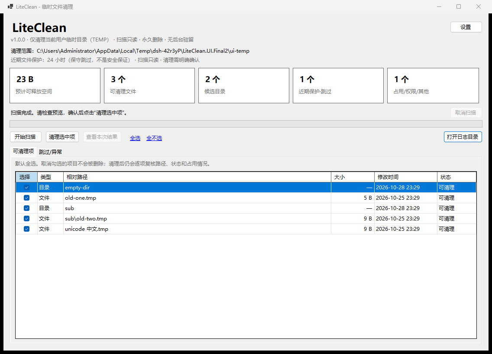
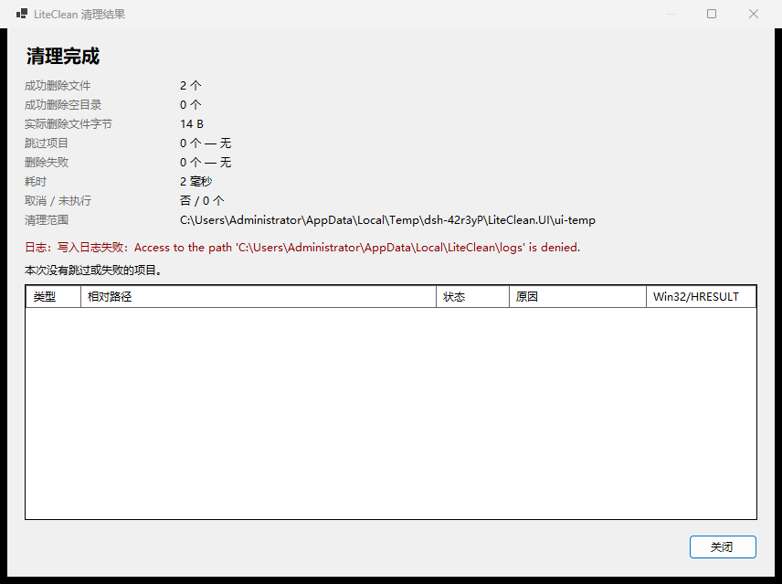
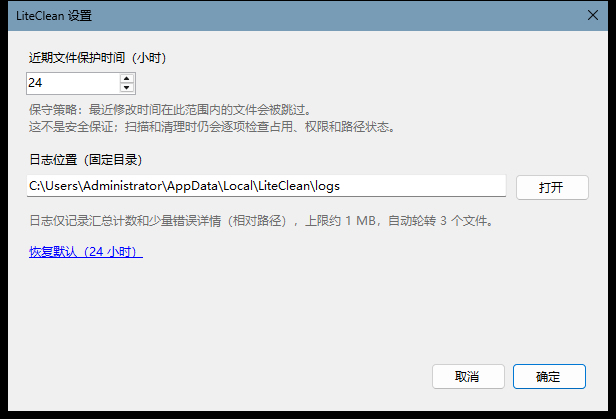

# LiteClean 1.0.0

LiteClean 是一款面向 Windows 10/11 x64 的轻量临时文件清理工具。它只清理当前用户 `TEMP` 目录中的可安全删除内容，扫描严格只读，清理前必须由用户确认；正在使用、权限不足、只读、近期修改、链接/重解析点或状态变化的项目会被跳过。

> 本项目已实际构建、运行和测试。本文中的测试、性能和产物体积数据来自本轮真实执行，不是模拟数据。
>
> 实测环境：Windows 11（NT 10.0.26200.0，x64）、.NET SDK 10.0.401、非管理员进程、无第三方 NuGet 依赖。



[GitHub 仓库](https://github.com/MinaMiKune/LiteClean) · [Release v1.0.0](https://github.com/MinaMiKune/LiteClean/releases/tag/v1.0.0)

## 1. 交付摘要

| 项目 | 结果 |
|---|---|
| 技术栈 | C# / .NET 10 LTS / Windows Forms |
| 项目版本 | 1.0.0 |
| 清理范围 | 仅当前用户 `TEMP`，无回退、无提权 |
| 核心测试 | 71 项：68 通过，0 失败，3 跳过 |
| 集成/安全测试 | 路径边界、目录联接、TOCTOU 替换、占用、只读、取消、统计一致性等 |
| 发布方式 | 框架依赖、便携文件夹、win-x64 |
| 发布依赖 | .NET 10 Desktop Runtime（实测 10.0.12） |
| 管理员权限 | 不需要，manifest 为 `asInvoker` |
| 第三方依赖 | 无 |
| 构建验证 | Release 构建 0 警告、0 错误 |
| 实测平台 | Windows 11 26200；Windows 10 未在本环境实测（见已知限制） |

## 2. 技术选型与原因

### 2.1 实际环境约束

开始实现前检查到：

- 操作系统：Windows 11 x64；
- 已安装 .NET SDK：只有 `10.0.401`；
- 已安装桌面运行时：`Microsoft.WindowsDesktop.App 8.0.19`、`10.0.12` 等；
- 未安装 .NET 8 SDK，也没有 .NET 8 targeting pack；NuGet 网络不可用（SSL 连接失败），无法下载 `Microsoft.NETCore.App.Ref` / `Microsoft.WindowsDesktop.App.Ref` 8.0；
- 没有可用的 Visual Studio C++ 工具链、git、Rust 等；有 .NET Framework 4.8 的旧 csc，但不适合现代安全 I/O 实现；
- 构建沙箱要求把 NuGet 配置、CLI home 和包缓存重定向到项目内，否则会访问只读的用户配置目录。

### 2.2 最终选择

选择 **C# + .NET 10 LTS + Windows Forms**：

- 目标系统是 Windows 10/11，WinForms 是系统原生 UI，启动快、依赖少、无 Chromium；
- .NET 10 是当前可用的 LTS，SDK 已安装，可离线构建；
- 使用 `System.IO`、`System.Threading.Channels`、`System.Text.Json` 和少量 kernel32 P/Invoke，无第三方包；
- 核心逻辑放在独立的 `LiteClean.Core`，GUI 不包含递归删除逻辑；
- 采用框架依赖发布，程序负载约 290 KiB，避免为“单文件”引入不可验证的 trimming/ILLink 风险。

**为什么没有直接用 .NET 8**：需求首选 .NET 8 LTS，但本机没有 .NET 8 SDK/targeting pack，且网络不可用，无法还原 `net8.0-windows` 所需的引用包。强行用 .NET 10 SDK 编译 net8 目标会 restore 失败；因此按实际环境选择 .NET 10 LTS，并把代码限制在 .NET 8 也具备的 API 范围内。若要严格使用 .NET 8，需要安装 .NET 8 SDK 后把三个项目的 TFM 改为 `net8.0-windows` 并重新验证；本环境未执行该验证。

### 2.3 发布方式对比（实际约束）

| 方式 | 体积/依赖 | 结论 |
|---|---|---|
| 框架依赖便携发布（采用） | 5 个文件，约 290 KiB；需要 .NET 10 Desktop Runtime | 已离线构建、已 smoke test、已实际运行 |
| 单文件框架依赖 | 需要 ILLink/runtime packs（`Microsoft.NET.ILLink.Tasks`、`Microsoft.NETCore.App.Runtime.win-x64` 等）；本环境 NuGet 不可用 | 未构建，未验证，不伪造 |
| 自包含 | 预计约 150 MB 以上；同样需要 runtime packs | 未构建；与“轻量”目标冲突 |
| Native AOT | WinForms/反射式 UI 与 AOT 兼容性不可靠 | 拒绝；不作为发布方案 |

README 和构建脚本只承诺已验证的框架依赖发布。

## 3. 功能

- 只读扫描 `TEMP`；
- 显示候选文件/目录数量、预计逻辑字节、近期保护跳过数、占用/权限/其他跳过数；
- 可展开候选项和跳过原因；
- 支持逐项勾选/取消勾选、全选、全不选；
- 清理前显示范围、数量、预计字节、跳过统计和不可撤销提示；
- 用户明确点击“是”后才删除；
- 清理结果：
  - 成功文件数；
  - 成功空目录数；
  - 实际删除文件字节；
  - 跳过数及原因；
  - 失败数及原因；
  - 耗时；
  - 是否取消；
  - 未执行数量；
- 取消扫描/取消清理；
- 近期文件保护时间设置（1–720 小时，默认 24）；
- 固定日志目录，大小上限和轮转；
- 设置持久化；
- 无网络、无遥测、无服务、无计划任务、无开机启动。





## 4. 安全设计

完整说明见 [docs/CLEANUP_BEHAVIOR.md](docs/CLEANUP_BEHAVIOR.md)。关键点：

1. **根目录只来自 `TEMP`**，缺失/相对/异常/UNC/设备/根目录/重解析点/受保护位置一律拒绝；不回退到 `TMP` 或 `C:\`。
2. **路径边界规范化**：每个候选项重新 `GetFullPath`、原始点/空格尾部检查、边界前缀检查、名称段检查、ADS/非法字符拒绝。
3. **不跟随重解析点**：符号链接、目录联接、挂载点一律跳过；目录扫描用显式栈，不使用无界递归。
4. **扫描只读**：仅打开句柄读取属性/身份，不删除；测试对文件内容和数量做前后快照比较。
5. **删除通过句柄**：清理时重新打开带 DELETE 权限、`FILE_FLAG_OPEN_REPARSE_POINT` 的句柄，验证类型、卷序列号+文件索引、大小、最后写入时间、句柄最终路径，再用 `SetFileInformationByHandle(FILE_DISPOSITION_INFO)` 删除；扫描后被替换成链接/其他文件/目录会被拒绝。
6. **近期文件保护**：默认跳过 24 小时内修改的文件；可配置 1–720 小时；文档明确说明这是保守策略，不是安全保证。
7. **跳过优先**：占用、共享冲突、权限不足、只读、无法确认路径、状态变化均跳过；单个失败不终止任务。
8. **不强行删除**：不请求管理员、不关闭安全软件、不终止进程、不修改 ACL、不清理回收站。
9. **用户授权**：确认对话框默认“否”；未确认不会执行删除。
10. **取消语义**：取消后不启动新删除；已完成删除不承诺恢复。
11. **日志安全**：固定 `%LOCALAPPDATA%\LiteClean\logs`，1 MiB × 3 轮转，只记录汇总和最多 30 条问题（相对路径），不记录文件内容或完整清单。
12. **发布权限**：`app.manifest` 使用 `asInvoker`，不要求管理员。

### 默认保护位置

磁盘根目录、Windows/System32/WinSxS 等系统目录、Program Files、Program Files (x86)、Common Files、ProgramData、`$Recycle.Bin`、Recovery、System Volume Information、Boot、EFI、PerfLogs、Windows.old、用户主目录/桌面/文档/下载/图片/音乐/视频/OneDrive/Public/Roaming/LocalAppData、应用自身目录、其他用户配置文件。

详细规则和“已知文件夹被重定向”的限制见行为说明文档。

## 5. 构建

### 5.1 环境要求

- Windows 10/11 x64；
- .NET SDK 10.0.401 或兼容的 .NET 10 SDK；
- PowerShell 7（`pwsh`）；
- 无第三方包，构建过程不需要联网。

### 5.2 一键构建/测试/发布

```powershell
cd LiteClean

# 构建 Release
.\scripts\build.ps1

# 构建并运行全部测试；结果写入 artifacts/test-results.txt
.\scripts\test.ps1

# 性能测试；结果写入 artifacts/benchmark-results.txt
.\scripts\benchmark.ps1

# 发布并 smoke test；产物在 artifacts/publish/
.\scripts\publish.ps1

# 全部步骤（可加 -SkipBenchmark）
.\scripts\verify.ps1
```

脚本会把 `DOTNET_CLI_HOME`、`NUGET_PACKAGES`、`APPDATA` 重定向到项目内 `.build-home` / `.build-packages`，并使用 `-m:1 /nodeReuse:false`，以适配本环境受限的 MSBuild 进程/管道权限。`NuGet.config` 清空了包源，保证无第三方包的离线还原。

### 5.3 直接命令

```powershell
$env:DOTNET_CLI_HOME = "$PWD\.build-home"
$env:NUGET_PACKAGES = "$PWD\.build-packages"
$env:APPDATA = "$PWD\.build-home\AppData\Roaming"
dotnet build .\LiteClean.sln -c Release -m:1 /nodeReuse:false -p:UseSharedCompilation=false
dotnet run --project .\tests\LiteClean.Tests -c Release --no-build
dotnet run --project .\tests\LiteClean.Tests -c Release --no-build -- --benchmark
```

## 6. 测试结果（真实执行）

命令：

```powershell
.\scripts\test.ps1
```

本轮结果：

```text
SUMMARY: total=71 passed=68 failed=0 skipped=3
```

（实际耗时随环境在约 5–6 秒间波动；精确值见原始日志。）

原始日志：[artifacts/test-results.txt](artifacts/test-results.txt)。

覆盖的关键场景：

- 空/不存在/相对/UNC/异常 `TEMP`；
- 磁盘根目录、Windows、用户目录、LocalAppData 等受保护位置；
- `..` 穿越、ADS、尾部点/空格别名、Unicode/空格/长路径；
- 重解析点根目录、目录联接、文件/目录符号链接；
- 正常文件、空文件、只读、被占用、大小/时间/身份变化；
- 扫描只读性（内容和数量快照）；
- 清理统计与文件系统一致性、空目录统计、重复清理；
- 扫描取消、清理取消、预取消；
- 扫描后文件被替换为另一个文件/链接、目录被替换为联接、根目录被替换为联接；
- 无权限/不可访问目录（ACL 用例在受限环境跳过；独占句柄不可访问用例通过）；
- 操作协调器并发/重入/过期完成/状态转换；
- 日志内容最小化、轮转、写入失败；设置读取/保存/校验。

### 3 个跳过项（未冒充通过）

1. `ScanTests.FileSymlinkIsNotFollowed`：当前进程没有 Developer Mode 或 `SeCreateSymbolicLinkPrivilege`，`CreateSymbolicLink` 返回 Win32 1314，无法创建文件符号链接。
2. `CleanTests.FileReplacedBySymlinkIsRefused`：同上，无法构造文件符号链接的 TOCTOU 场景。
3. `SafetyTests.NoPermissionDirectoryIsSkipped`：受限环境不允许测试进程设置 deny ACL；改用独占目录句柄的不可访问目录用例已通过。

目录联接（junction）用例在当前环境实际创建并通过，验证了重解析点不被跟随、未越界删除。文件/目录符号链接的处理代码与 junction 共用 reparse point 拒绝路径，但本环境无法完成符号链接的真实集成验证。

**平台说明**：全部测试在 Windows 11 x64 上运行；没有使用 Linux 结果冒充 Windows 结果。Windows 10 未在本环境实际运行。

## 7. 性能与资源占用（实测）

完整方法和数据见 [docs/PERFORMANCE.md](docs/PERFORMANCE.md)。

| 数据规模 | 扫描 | 清理 | 峰值工作集* | managed heap（扫描后） |
|---|---:|---:|---:|---:|
| 6030 文件 / 623 目录 / 29.3 MB | 1021 ms，约 5904 文件/秒 | 3582 ms，约 1684 文件/秒 | 46.7 MB | 5.4 MB |
| 20045 文件 / 623 目录 / 52.2 MB | 4312 ms，约 4649 文件/秒 | 12393 ms，约 1617 文件/秒 | 62.3 MB | 10.5 MB |

\* 单进程生命周期峰值，包含测试数据生成，属于保守上界；不是固定承诺。运行间存在约 5–10% 波动。

压力用例包含一个约 17,000 文件的宽目录和 120 层深目录。扫描/清理均已校验计数与文件系统状态。

## 8. 运行与发布

### 8.1 直接运行构建产物

```powershell
.\src\LiteClean.App\bin\Release\net10.0-windows\LiteClean.exe
```

### 8.2 发布目录

运行：

```powershell
.\scripts\publish.ps1
```

产物：

```text
artifacts/publish/LiteClean-win-x64-framework-dependent/
  LiteClean.exe
  LiteClean.dll
  LiteClean.Core.dll
  LiteClean.deps.json
  LiteClean.runtimeconfig.json
  README.md
  SHA256SUMS.txt
  docs/
    CLEANUP_BEHAVIOR.md
    PERFORMANCE.md
    screenshots/
```

- 版本：1.0.0
- 架构：win-x64
- 类型：框架依赖便携发布（非自包含、非单文件）
- 程序负载（exe + dll + deps + runtimeconfig）：297,271 字节
- 运行要求：Windows x64 + .NET 10 Desktop Runtime（实测 10.0.12）
- 首次运行不需要管理员权限
- `LiteClean.exe --smoke-test` 只创建主窗体并退出，用于验证 UI 初始化；已通过（exit code 0）

> 发布目录/ZIP 的精确大小和 SHA256 由 `publish.ps1` 写入 `artifacts/SHA256SUMS.txt` 与发布目录内的 `SHA256SUMS.txt`。由于 README 本身会随发布更新，本文不预填会因再次打包而变化的 ZIP 哈希。

## 9. 日志与设置

- 日志：`%LOCALAPPDATA%\LiteClean\logs\liteclean.log`
- 设置：`%LOCALAPPDATA%\LiteClean\settings.json`
- 日志上限：单文件 1 MiB，当前 + 2 个归档
- 日志内容：汇总计数、原因分布、耗时、取消标记、最多 30 条问题（相对路径、状态、原因、Win32 错误码）；不记录文件内容、凭据或完整文件清单
- 日志写入失败会显示提示，不中断清理
- 日志目录固定，UI 只展示并可打开，不接受任意路径输入

## 10. 项目结构

```text
LiteClean/
├─ LiteClean.sln
├─ Directory.Build.props
├─ NuGet.config                  # 清空包源，离线、无第三方依赖
├─ README.md
├─ docs/
│  ├─ CLEANUP_BEHAVIOR.md        # 清理行为与安全边界
│  ├─ PERFORMANCE.md             # 性能方法与实测数据
│  └─ screenshots/
├─ scripts/
│  ├─ common.ps1
│  ├─ build.ps1
│  ├─ test.ps1
│  ├─ benchmark.ps1
│  ├─ publish.ps1
│  └─ verify.ps1
├─ src/
│  ├─ LiteClean.Core/            # 无 UI 的核心：路径、扫描、清理、设置、日志、状态机
│  │  ├─ Security/
│  │  ├─ Scanning/
│  │  ├─ Cleaning/
│  │  ├─ Configuration/
│  │  ├─ Logging/
│  │  ├─ Models/
│  │  ├─ Native/
│  │  └─ Workflow/
│  └─ LiteClean.App/             # WinForms 1.0.0
│     ├─ Program.cs
│     ├─ MainForm.cs
│     ├─ SettingsForm.cs
│     ├─ ResultForm.cs
│     ├─ AppText.cs
│     └─ app.manifest            # asInvoker / PerMonitorV2 / longPathAware
├─ tests/
│  └─ LiteClean.Tests/           # 无第三方测试运行器；71 个测试
│     ├─ TestHarness.cs
│     ├─ TestWorkspace.cs
│     ├─ Benchmark.cs
│     └─ *Tests.cs
├─ artifacts/                    # 测试结果、性能结果、发布产物
└─ .gitignore
```

## 11. 质量检查

- `dotnet build -c Release`：0 警告、0 错误（`TreatWarningsAsErrors=true`，启用 .NET analyzers）；
- 无第三方 NuGet 包；
- 无调试输出/模拟数据/宽泛通配符删除；
- 扫描与清理独立服务；
- UI 通过 `Task.Run` 后台执行，`await` 回到 UI 线程；
- 操作状态机有独立单元测试；
- 日志/设置路径固定；
- `dotnet format --verify-no-changes` 在当前沙箱下因命名管道权限失败（未能执行代码格式器）；因此不声称格式器检查通过。编译器分析与构建警告已作为质量门槛。

## 12. 已知问题、风险与未完成事项

1. **仅实测 Windows 11 26200 x64**；Windows 10 未在本环境运行。理论上 .NET 10 + WinForms 支持 Windows 10/11，但需在目标机器复验。
2. **未签名**：EXE 没有代码签名，SmartScreen 可能提示；无安装器/升级机制。
3. **框架依赖**：需要 .NET 10 Desktop Runtime；未提供自包含/单文件发布（本环境无 NuGet runtime packs）。
4. **未构建 ARM64/x86**；`Directory.Build.props` 设置 `PlatformTarget=x64`，发布命令按 win-x64 验证。
5. **文件/目录符号链接集成测试跳过**（缺少权限）；junction 测试通过；代码统一拒绝所有 reparse point。
6. **ACL deny 测试跳过**（沙箱不允许设置 ACL）；独占句柄不可访问用例通过。
7. **候选列表占用内存**：为逐项选择保留候选记录；数百万文件场景尚未做分页/索引优化。
8. **统计口径**：物理空间可能因硬链接、稀疏、压缩、去重而小于逻辑字节；不承诺磁盘剩余空间增加相同值。
9. **扫描进度非百分比**：无预扫描，采用不确定进度条与实时计数。
10. **自定义 TEMP 限制**：用户配置目录内只允许 `%LOCALAPPDATA%\Temp` 子树；其他自定义位置拒绝。
11. **未实现回收站模式/撤销**：删除是永久的，避免误导。
12. **UI 自动化**：主界面、扫描结果、确认框“否/是”、设置、结果对话框均已通过 Win32/UIAutomation 手工脚本验证；没有纳入 CI。
13. **日志在受限沙箱中写失败**：已显示错误且清理继续；正常用户环境应可写。
14. **无本地化**：仅简体中文 UI/README。
15. **无自动更新/在线遥测**：有意为之。

## 13. 安全验收对照

| 验收项 | 实现/证据 |
|---|---|
| 仅当前用户 TEMP | `TempRootResolver`；无 TMP/根目录回退 |
| 扫描与清理分离 | `TempScanner` / `TempCleaner`；UI 不删除 |
| 清理前确认 | `MessageBox` Yes/No，默认 No；实测“否”不删除、“是”才删除 |
| 路径边界 | `PathBoundary`；边界/穿越/ADS/长路径测试 |
| 重解析点 | 全扫描跳过、删除前拒绝；junction 实测；符号链接测试明确跳过 |
| 单个失败不崩溃 | 逐项目异常记录；占用/只读/不存在测试 |
| UI 不长时间假死 | 后台任务 + 节流进度；`OperationCoordinator` 测试 |
| 统计真实 | 句柄读取大小、删除后确认路径消失；统计一致性测试 |
| 核心测试通过 | 71 项：68 通过、0 失败、3 跳过并说明原因 |
| 文档与实现一致 | 本文与 `CLEANUP_BEHAVIOR.md` 对应当前代码 |
| 不要求管理员 | `asInvoker`；实测进程非管理员 |
| 不修改系统 | 无注册表/服务/计划任务/浏览器数据操作 |

## 14. 最终构建记录

- 构建命令：`.\scripts\build.ps1`、`.\scripts\test.ps1`、`.\scripts\publish.ps1`
- 构建时间：2026-10-28（Asia/Hong_Kong）
- 构建结果：Release，0 警告、0 错误
- 测试结果：71 total / 68 passed / 0 failed / 3 skipped（见 `artifacts/test-results.txt`）
- 发布版本/架构：LiteClean 1.0.0 / win-x64 / framework-dependent
- 程序负载：297,271 字节（`LiteClean.exe` 163,328；`LiteClean.Core.dll` 82,432；`LiteClean.dll` 50,176；`LiteClean.deps.json` 816；`LiteClean.runtimeconfig.json` 519）
- 依赖：.NET 10 Desktop Runtime（实测 10.0.12）；无第三方包
- `LiteClean.exe --smoke-test`：exit code 0
- 发布路径：`artifacts/publish/LiteClean-win-x64-framework-dependent/`
- ZIP：[GitHub Release v1.0.0 附件](https://github.com/MinaMiKune/LiteClean/releases/tag/v1.0.0)
- 精确目录体积、ZIP 体积与 SHA256：见 `artifacts/SHA256SUMS.txt` 和发布目录内 `SHA256SUMS.txt`（由最终发布脚本生成）

## 15. 使用提醒

LiteClean 只应清理临时目录。临时目录里也可能包含正在写入的日志、安装程序缓存或某些应用自己的状态文件。程序会尽量跳过，但**删除仍然是永久的**。如果你不确定某个候选文件是否必要，请先取消勾选。不要为了清理更多文件而修改 `TEMP` 到桌面、下载或文档目录；程序会拒绝这些位置。
